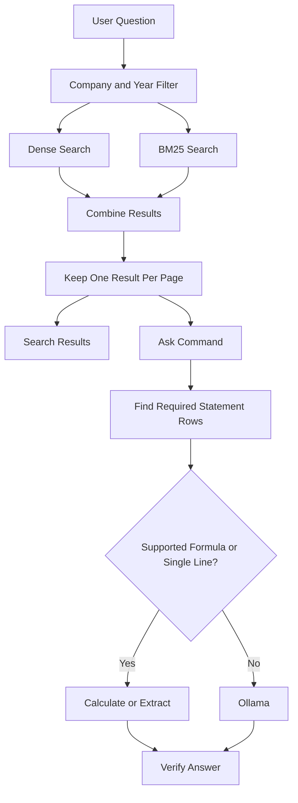

# Filing Question Answering

This project answers questions using information from company financial filings.

- `search` finds relevant pages and table rows.
- `ask` provides an answer with citations.
- The system checks whether answer numbers are supported by the cited evidence.
- It can also calculate and verify certain financial formulas directly.

## 1. How to Run

### Requirements

- Python and the packages listed in `requirements.txt`
- Ollama with the `llama3.2:latest` model for questions that need an LLM
- The existing dense and BM25 indexes

### Install dependencies

From the project folder (`D:\ass`), run:

```powershell
pip install -r requirements.txt
```

Make sure Ollama is installed and the model is available:

```powershell
ollama pull llama3.2:latest
```

Ollama must be running at `http://localhost:11434` when an answer needs the model.

### Available roles

The system supports four roles:

- `consumer`
- `health_industrials`
- `tech_telecom`
- `lead`

The first three roles can access their assigned companies. The `lead` role can access all companies.

### Search and ask commands

```powershell
python main.py search --role tech_telecom "question text"

python main.py ask --role tech_telecom "question text"
```

The `search` command displays retrieved results.

The `ask` command returns a JSON answer with citations and verification information.

You can optionally use `--rerank` with either command. Reranking is disabled by default.

### Rebuild the indexes

The project already contains its dense and BM25 indexes:

- Dense index: `data/chroma_db`
- BM25 index: `data/fts_index.sqlite3`

To rebuild them from the PDFs, run:

```powershell
python main.py ingest pdfs
```

Only rebuild the indexes when needed.

## 2. Project Architecture

The system uses two search methods:

- **Dense search:** Finds information based on meaning.
- **BM25 search:** Finds information based on matching keywords.

The results from both methods are combined using Reciprocal Rank Fusion (RRF). The system then keeps one result per page for normal search.

The `ask` command also looks for financial statement rows named in the question. This helps when a calculation needs multiple rows from the same page.

For supported financial formulas, the system extracts the required values, performs the calculation, and checks the result.

For other questions, it uses Ollama with the `llama3.2:latest` model.

Every answer must include citations. Numbers must be supported by cited evidence or by a verified calculation using cited inputs.

### Main workflow



## 3. Retrieval Evaluation

Run the evaluation script:

```powershell
python eval/evaluate_retrieval.py
```

The script evaluates:

- 20 development questions from `dev_questions.jsonl`
- 10 holdout questions from `questions.jsonl` with IDs starting with `gks_`

It uses a top-10 result limit and company/year filtering.

The evaluation reports three main metrics:

- **Recall:** How many expected pages were found.
- **MRR:** How high the first correct result appeared in the ranking.
- **Hit:** Whether at least one expected page appeared in the top results.

The evaluation measures retrieval results. It does not call Ollama or evaluate generated answer text.

### Evaluation results

The two charts below summarize the latest recorded retrieval run. The default method is chunk-level RRF with one result kept per page (`chunk+dedupe1`). Reranking is optional and is not used by default. Exact values are in the tables that follow.

#### Development vs holdout — hit rate

Hit rate is the share of questions for which at least one expected page appeared in the top 10. Higher is better.


#### Default vs reranker — MRR

MRR measures how early the first correct page appears. A higher MRR means relevant results appear earlier.


The evaluation used 20 development questions and 10 holdout questions. The set is small, so these charts describe that run only. They are not a guarantee of overall system accuracy.

### Latest recorded results

The production retrieval method is chunk-level RRF followed by keeping one result per page (`chunk+dedupe1`).

| Dataset | Questions | Recall | Hit | MRR |
|---|---:|---:|---:|---:|
| Development | 20 | 0.5500 | 0.6000 | 0.3910 |
| Holdout | 10 | 0.9000 | 1.0000 | 0.5067 |

These results are for normal retrieval. They do not include the additional statement rows that the `ask` command retrieves.

Reranking was tested but was not selected as the default method. Its latest recorded results were:

| Dataset | Hit | MRR | Average time |
|---|---:|---:|---:|
| Development | 0.70 | 0.3514 | 1,426 ms |
| Holdout | 0.90 | 0.7700 | 1,485 ms |

Reranking remains optional and is disabled by default.

## 4. Answer Testing

The following questions were tested manually after the answer-side changes.

| Test | Result |
|---|---|
| AMD FY2022 revenue | $23,601 million, cited to page 49 |
| Corning FY2020 DPO | 63.86 days, calculation verified using pages 70 and 72 |
| MGM FY2018 accounts payable | 303 million, calculation and unit conversion verified using page 57 |
| Boeing FY2018 net PP&E | 12,645 million, cited to page 52 |
| Unsupported question | System refused to provide an unsupported answer |
| Incorrect number | A fabricated number was flagged as unverified |

The numeric verification check confirms whether numbers appear in the cited evidence. It is not a complete semantic fact-checker for every possible statement.

## 5. Known Limitations

- Normal `search` keeps only one result per page. A question that needs multiple rows from the same page may need the additional retrieval performed by `ask`.
- The retrieval evaluation measures normal search results. It does not measure the extra statement rows added by `ask`.
- Direct formula calculation is currently limited to supported questions containing `defined as:`.
- Other calculations, such as some margin and working capital questions, may still need the language model.
- The statement-line lookup uses a fixed list of known financial terms. A line outside this list depends on normal hybrid retrieval.
- Some capital expenditure questions do not match the direct single-line lookup path.
- A calculated answer without a valid calculation block may be returned as `answered_unverified`.
- Numeric verification checks whether numbers are present in cited evidence. It does not prove that every number has the correct financial meaning.
- The current refusal check uses a dense retrieval score threshold of 0.50. A question that is not answered in a filing may still retrieve relevant-looking pages, so refusal is not guaranteed in every case.

## 6. Project Data

Main project folders and files:

| Path | Purpose |
|---|---|
| `pdfs/` | Source PDF filings |
| `data/` | Extracted data and search indexes |
| `src/` | Project source code |
| `eval/` | Retrieval evaluation script |
| `tests/` | Test files |
| `manifest.csv` | Filing and company information |
| `questions.jsonl` | Evaluation questions |
| `dev_questions.jsonl` | Development questions |
| `DECISIONS.md` | Technical decisions |
| `EXPERIMENTS.md` | Experiments and their results |
| `requirements.txt` | Python dependencies |
