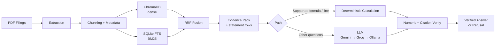
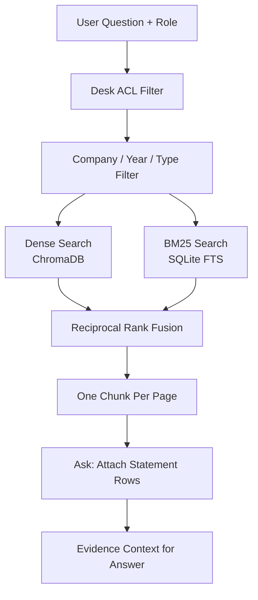
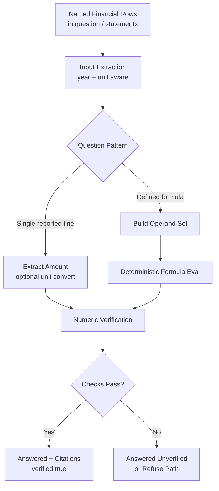
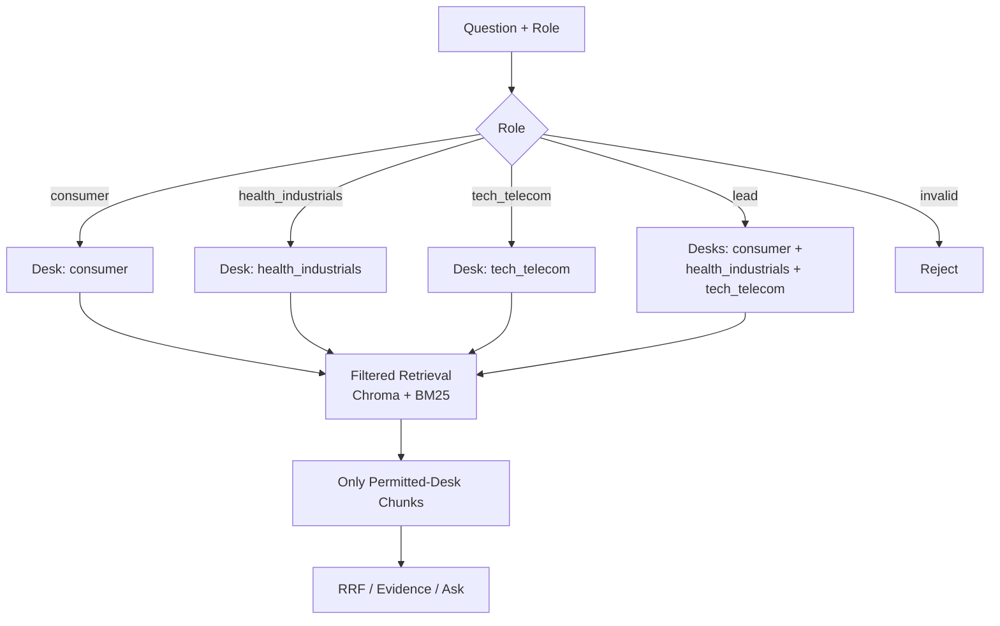
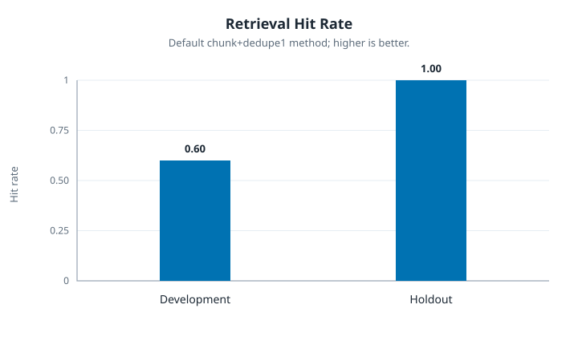
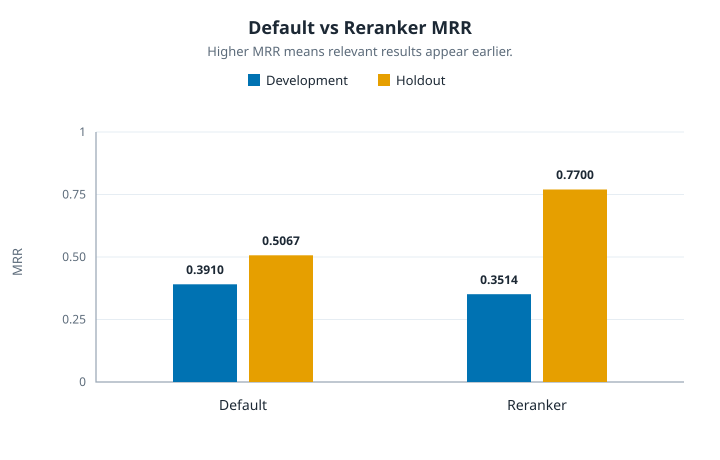
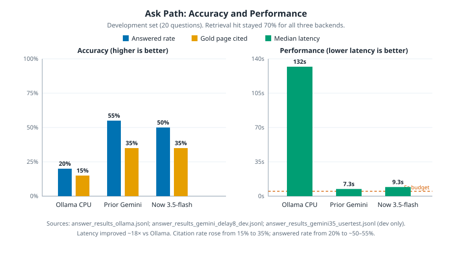

# Filing Question Answering

A grounded question-answering system for company financial filings, built using Python, hybrid retrieval, financial statement extraction, and LLM-based answer generation.

The system retrieves evidence from company filings and uses that evidence to answer financial and business questions with page-level citations.

It combines deterministic financial data processing with language-model-based reasoning to improve answer traceability and reduce unsupported claims.

## Key Capabilities

- **Hybrid RAG retrieval:** Combines dense vector search and BM25 using Reciprocal Rank Fusion (RRF).
- **Financial statement extraction:** Retrieves specific financial statement rows and values from company filings.
- **Deterministic calculations:** Calculates supported financial formulas and verifies the arithmetic.
- **Evidence-based answers:** Returns answers with document, page, and evidence citations.
- **Numeric verification:** Checks numeric claims against cited evidence or verified calculations.
- **Role-based access control:** Enforces desk-level data access restrictions during retrieval.
- **LLM integration:** Uses Gemini as the primary answer provider with Groq fallback.
- **Retrieval evaluation:** Measures Recall, Hit, and MRR on development and holdout questions.
- **Answer evaluation:** Separately measures retrieval coverage, citation coverage, answer completion, and verification.
- **Performance and reliability:** Includes response caching, provider fallback, latency experiments, and zero-API diagnostics.

## Engineering Capabilities Demonstrated

| Engineering area | Implementation |
|---|---|
| Python development | Modular application logic, CLI commands, and processing pipelines |
| RAG architecture | PDF ingestion, extraction, chunking, embeddings, and retrieval |
| Information retrieval | Dense search, BM25, RRF, and optional cross-encoder reranking |
| Database engineering | ChromaDB vector storage and SQLite FTS |
| LLM integration | Gemini, Groq fallback, prompt design, and response caching |
| Financial data processing | Statement-line extraction, year matching, and unit conversion |
| Calculation verification | Deterministic formula execution and numeric checks |
| Backend engineering | CLI workflows, configuration, structured JSON responses |
| Access control | Retrieval-level role and desk restrictions |
| AI evaluation | Development/holdout datasets, retrieval metrics, and answer evaluation |
| Performance engineering | Latency profiling, API quota handling, and fallback strategies |

---

## 1. System Architecture

The project follows a retrieval-augmented architecture.

Financial filing PDFs are processed into searchable text and table-oriented chunks. The extracted information is indexed using both dense vector search and BM25.

When a question arrives, the system retrieves relevant evidence, applies access restrictions, and either performs a supported deterministic financial operation or sends the evidence to the configured answer-generation model.

### Architecture overview

End-to-end pipeline (ingest once; then search/ask at query time):



Query-time detail (filters and fusion):



### Retrieval methods

**Dense vector search**

Uses embeddings to retrieve semantically related passages, even when the wording of a question differs from the source document.

**BM25 search**

Uses keyword-based retrieval to identify exact terms, financial statement labels, and terminology found in the filings.

**Reciprocal Rank Fusion**

Combines the ranked results from dense retrieval and BM25 without requiring both methods to produce scores on the same scale.

### Default retrieval configuration

| Setting | Value |
|---|---:|
| Dense retrieval | Enabled |
| BM25 retrieval | Enabled |
| RRF constant | `60` |
| BM25 weight | `1` |
| Fusion level | Chunk |
| Final normal search results | One chunk per page |
| Company/year filtering | Applied before retrieval when identified |

### Financial statement retrieval

Normal search keeps one result per page to improve result diversity.

The `ask` command can perform additional financial statement row retrieval when a question requires multiple values from the same page.

This allows the system to handle questions involving financial statement line items, multiple reporting years, unit conversions, and supported financial formulas.

---

## 2. Financial Calculation and Verification

One of the project's important capabilities is the ability to handle selected financial questions without relying entirely on an LLM for arithmetic.

### Calculation pipeline



The calculation checker verifies that:

- Inputs come from cited evidence or the question.
- Intermediate steps match the stated arithmetic.
- The formula produces the stated result.
- Rounding / unit conversion follow the filing and question.

An incomplete or unsupported calculation is not treated as verified.

### Direct financial statement extraction

For supported single-line questions, the system can extract a reported financial value directly.

Example:

- Identify the requested company and year.
- Find the matching financial statement line.
- Extract the reported amount.
- Convert the unit if necessary.
- Verify the conversion.

### Formula-based calculations

For supported questions containing an explicit formula, the system can retrieve the required financial statement inputs and calculate the result.

Example calculation:

```text
365 × Average Accounts Payable / Cost of Sales
```

### Tested financial examples

| Example | Result |
|---|---|
| AMD FY2022 revenue | $23,601 million, cited to page 49 |
| Corning FY2020 DPO | 63.86 days, verified using pages 70 and 72 |
| MGM FY2018 accounts payable | 303 million USD, converted and verified using page 57 |
| Boeing FY2018 net PP&E | 12,645 million USD, cited to page 52 |

Direct extraction and calculation are currently supported for selected question patterns. Other financial metrics may still require LLM-based interpretation.

---

## 3. Role-Based Access Control

The system enforces access restrictions during retrieval rather than relying only on prompt instructions.

Each role is mapped to its permitted desks. The desk restriction is applied to both Chroma vector retrieval and BM25 SQL retrieval.

### Available roles

| Role | Permitted access |
|---|---|
| `consumer` | Consumer desk |
| `health_industrials` | Health and industrials desk |
| `tech_telecom` | Technology and telecom desk |
| `lead` | All desks |

### Access-control workflow

Roles map to filing desks. The desk filter is applied **inside retrieval** (Chroma `where` + BM25 SQL), not only in the LLM prompt.



This prevents unauthorized desk evidence from entering the answer-generation context through the normal retrieval path.

Company and year filters can further narrow the search when the question identifies them.

---

## 4. How to Run

### Requirements

- Python
- Packages listed in `requirements.txt`
- Source PDF filings if rebuilding indexes
- Existing dense and BM25 indexes for normal usage
- A configured answer backend for questions requiring an LLM

### Install dependencies

Run these commands from the project folder:

```powershell
pip install -r requirements.txt
copy .env.example .env
```

### Configure environment variables

Add the required provider API keys to `.env`.

```env
GEMINI_API_KEY=your_gemini_api_key
GROQ_API_KEY=your_groq_api_key

ANSWER_PROVIDER=gemini
GEMINI_MODEL=gemini-3.5-flash
```

The default provider configuration is:

- **Gemini:** Primary answer provider.
- **Groq:** Fallback for supported Gemini quota, rate-limit, or temporary provider failures.
- **Ollama:** Retained as an experimental code path, not an active default provider.

`LLM_REQUEST_DELAY_S` can be configured to space evaluation requests. Delays do not increase provider rate limits or daily quotas.

### Available CLI commands

The project exposes three main commands:

```text
python -m main ingest
python -m main search
python -m main ask
```

### Search

Search for relevant filing evidence:

```powershell
python -m main search --role tech_telecom --k 5 "What was AMD's revenue in FY2022?"
```

The search command displays retrieved results with document and page information.

### Ask

Generate an answer using the retrieved evidence:

```powershell
python -m main ask --role tech_telecom "What was AMD's revenue in FY2022?"
```

The ask command returns a structured JSON response containing the answer, citations, and verification information.

### Optional reranking

Reranking can be enabled using `--rerank`:

```powershell
python -m main search --role tech_telecom --k 5 --rerank "What was AMD's revenue in FY2022?"
```

Reranking is disabled by default because its evaluation results did not justify adding its latency to every query.

### Rebuild indexes

Existing indexes are stored in:

| Index | Location |
|---|---|
| Dense vector index | `data/chroma_db/` |
| BM25 index | `data/fts_index.sqlite3` |

To rebuild indexes from the PDF corpus:

```powershell
python -m main ingest pdfs
```

Rebuilding is not necessary for normal usage when the existing indexes are available.

---

## Visual summary

The README uses **6 visuals** total:

| # | Visual | Type | Section |
|---|---|---|---|
| 1 | System architecture (ingest + ask) | Mermaid | §1 |
| 2 | RBAC / desk access | Mermaid | §3 |
| 3 | Financial calculation pipeline | Mermaid | §2 |
| 4 | Retrieval hit rate | SVG chart | §5 |
| 5 | Default vs reranker MRR | SVG chart | §5 |
| 6 | Ask-backend accuracy & latency | SVG chart | §6 |

---

## 5. Retrieval Evaluation

The retrieval evaluation measures how effectively the search system finds expected filing pages.

Run:

```powershell
python eval/evaluate_retrieval.py
```

### Evaluation dataset

- 20 development questions from `dev_questions.jsonl`
- 10 holdout questions from `questions.jsonl`, with IDs beginning with `gks_`

The evaluation uses a top-10 result limit and company/year filtering.

### Evaluation metrics

| Metric | Meaning |
|---|---|
| Recall | How many expected pages were retrieved |
| Hit | Whether at least one expected page appeared in the top results |
| MRR | How highly the first correct result appeared in the ranking |

The retrieval evaluation measures normal search results. It does not evaluate generated answer text or include the additional statement rows retrieved by `ask`.

### Latest recorded retrieval results

The default retrieval method is chunk-level RRF followed by keeping one result per page (`chunk+dedupe1`).

| Dataset | Questions | Recall | Hit | MRR |
|---|---:|---:|---:|---:|
| Development | 20 | 0.5500 | 0.6000 | 0.3910 |
| Holdout | 10 | 0.9000 | 1.0000 | 0.5067 |

### Retrieval hit rate

Hit rate represents the percentage of questions for which at least one expected page appeared in the top 10 results.



### Default retrieval vs reranking

| Dataset | Method | Hit | MRR | Average reranking time |
|---|---|---:|---:|---:|
| Development | Default | 0.60 | 0.3910 | — |
| Development | Reranking | 0.70 | 0.3514 | 1,426 ms |
| Holdout | Default | 1.00 | 0.5067 | — |
| Holdout | Reranking | 0.90 | 0.7700 | 1,485 ms |



Reranking improved holdout MRR but lost one correct holdout hit and added processing time.

**Decision:** Keep reranking optional and disabled by default.

These results describe the recorded evaluation set and should not be interpreted as a guarantee of general accuracy.

---

## 6. Answer Evaluation

Answer evaluation measures how well the complete `ask` pipeline retrieves evidence, generates answers, and cites the expected pages.

This is separate from normal retrieval evaluation.

### Backend comparison

The development comparison includes local CPU Ollama, an earlier Gemini Delay-8 run, and a Gemini 3.5 Flash user test.

| Backend | Answered | Gold cited | Median latency | Ask-path hit |
|---|---:|---:|---:|---:|
| Ollama CPU | 4/20 (20%) | 3/20 (15%) | 132s | 70% |
| Prior Gemini Delay-8 | 11/20 (55%) | 7/20 (35%) | 7.3s | 70% |
| Gemini 3.5 Flash user test | 10/20 (50%) | 7/20 (35%) | 9.3s | 70% |



Hosted Gemini substantially reduced latency compared with local CPU Ollama. However, the recorded hosted API runs still exceeded the approximate five-second target on average.

### Latest 30-question ask-path snapshot

The Gemini 3.5 Flash baseline used 20 development questions and 10 holdout questions.

| Metric | Development (20) | Holdout (10) | Total (30) |
|---|---:|---:|---:|
| Ask-path retrieval hit | 14/20 (70%) | 9/10 (90%) | 23/30 (77%) |
| Gold page cited | 7/20 (35%) | 4/10 (40%) | 11/30 (37%) |
| Answered | 10/20 (50%) | 6/10 (60%) | 16/30 (53%) |
| Provider errors | 3/20 | 2/10 | 5/30 |
| Median latency | 9.3s | 8.9s | 8.9s |

Provider errors included HTTP 503 high-demand and HTTP 429 quota errors.

### Citation-repair retest

A separate citation-repair retest was performed on 15 uncited or problematic question IDs.

When blended with the original 30-question baseline, the overlay showed approximately:

- 27/30 answered
- 15/30 with a gold page cited

This was an overlay on the baseline, not a fresh independent 30-question run.

A `cited_gold` result means a returned citation matched the expected gold document and page. It does not establish complete semantic answer correctness.

### Offline evaluation without API calls

Run:

```powershell
python offline_eval.py eval/questions_all30.jsonl
```

The latest recorded evaluation produced:

| Outcome | Count |
|---|---:|
| Deterministic answer without LLM, with gold citation | 3/30 |
| Needs LLM and gold evidence already in context | 21/30 |
| Gold evidence absent from context | 6/30 |

This helps separate answer-generation problems from retrieval problems.

If gold evidence is already present, the issue may be answer generation or citation behavior. If gold evidence is missing, changing the LLM alone is unlikely to solve the retrieval problem.

### Gold-page ranking diagnostics

Run:

```powershell
python gold_rank.py eval/questions_all30.jsonl --rerank
```

This helps identify questions where expected evidence is missing, ranked too low, or available but not cited.

Relevant evaluation files include:

- `eval/ids_worth_api.txt`
- `eval/ids_skip_api_no_gold_ctx.txt`
- `eval/questions_passed_cited.jsonl`
- `eval/questions_failed_uncited.jsonl`

Successful LLM responses are cached in `data/llm_cache.json`, which is gitignored.

---

## 7. Performance and Latency

The project was developed and evaluated on CPU-only hardware.

Local Ollama CPU inference was too slow for the approximate five-second target, with an observed median of around 132–134 seconds in the recorded experiments.

Moving answer generation to hosted Gemini and Groq reduced latency substantially.

However, the latest recorded Gemini user test had an end-to-end median of approximately 8.9 seconds.

### Where optimization can help

| Component | Potential GPU impact |
|---|---|
| PDF extraction | Usually limited |
| Local embeddings | Can improve processing speed |
| Dense vector search | Depends on index and workload |
| BM25 / SQLite | Usually limited |
| Cross-encoder reranking | Can improve inference speed |
| Local LLM inference | Can improve inference speed substantially |
| Hosted Gemini / Groq generation | Not directly accelerated by a local GPU |

### Performance target

The approximate five-second target remains an optimization objective, not a demonstrated production result.

GPU acceleration is expected to help local embedding and reranking workloads. Hosted model generation remains dependent on network latency, provider load, and API availability.

Consistently achieving the target would require profiling and optimizing each stage, reducing unnecessary retrieval and generation work, and benchmarking the intended production environment.

---

## 8. Known Limitations

### Retrieval

- Normal `search` keeps one result per page. Questions requiring multiple rows from the same page may need additional retrieval through `ask`.
- Retrieval evaluation does not measure additional statement rows retrieved by `ask`.
- Some expected gold pages remain outside the top results or appear deep in the candidate pool.
- The statement-line lookup uses a fixed list of known financial terms. Other line items depend on normal hybrid retrieval.

### Answer generation

- Citation coverage remains lower than retrieval hit rate.
- Some questions require metric definitions that differ from their gold evaluation definitions.
- Free-tier Gemini and Groq quotas can interrupt long evaluation runs.
- Temporary provider errors can affect answer completion.
- Refusal behavior is not fully consistent across all unsupported questions.

### Verification

- Numeric verification does not establish full semantic correctness.
- Citation presence does not prove that the cited evidence supports every claim.
- Rounded values and unit conversions can require special handling.
- `verified=true` must not be treated as benchmark accuracy.
- Structured expected-answer fields are used for offline evaluation only.

### Financial calculations

- Direct formula calculation currently supports selected question patterns, including questions containing `defined as:`.
- Other calculations, such as some margin and working-capital questions, may still require LLM interpretation.
- Some capital expenditure questions do not match the direct single-line lookup path.
- A calculated answer without a valid calculation block may be returned as `answered` with `verified=false`.

### Performance

- End-to-end answer latency often exceeds the approximate five-second target on the tested CPU-only laptop.
- GPU acceleration may improve local embedding and reranking stages.
- Hosted model generation remains network- and provider-dependent.

---

## 9. Future Improvements

The following items are potential next steps, not completed features.

### Retrieval quality

- Improve retrieval of financial statement rows and tables.
- Investigate questions where the expected gold page appears too low in the candidate ranking.
- Improve metric-specific retrieval for working capital, margins, and capital intensity.
- Evaluate alternative chunking and reranking strategies against the existing baseline.

### Answer quality and grounding

- Improve citation precision so each factual claim is linked to supporting evidence.
- Strengthen refusal behavior for questions unsupported by the available filings.
- Improve financial metric disambiguation and unit-aware numeric verification.
- Expand deterministic extraction and calculation coverage.

### Performance and reliability

- Profile embedding, retrieval, reranking, and generation latency independently.
- Benchmark GPU-accelerated local embedding and reranking.
- Evaluate smaller or faster answer models where appropriate.
- Improve provider fallback, retry handling, and quota management.
- Measure latency under realistic production workloads.

### Testing and evaluation

- Expand development and holdout question sets.
- Add more negative and unsupported-question tests.
- Improve semantic answer evaluation beyond citation matching and numeric checks.
- Add regression tests for financial formulas, access restrictions, and citation verification.

---

## 10. Project Structure

| Path | Purpose |
|---|---|
| `pdfs/` | Source PDF filings |
| `data/` | Extracted data, indexes, and local cache |
| `src/` | Application and retrieval source code |
| `eval/` | Retrieval and answer evaluation scripts and results |
| `docs/figures/` | README evaluation charts |
| `tests/` | Test files |
| `manifest.csv` | Filing and company metadata |
| `questions.jsonl` | Evaluation questions, including holdout `gks_*` questions |
| `dev_questions.jsonl` | Development questions |
| `gold_rank.py` | Zero-API gold-page ranking diagnostic |
| `offline_eval.py` | Zero-API deterministic and LLM-needed question split |
| `DECISIONS.md` | Architecture and technical decisions |
| `EXPERIMENTS.md` | Experiments and evaluation results |
| `AI_NOTES.md` | Documentation of AI tool usage |
| `.env.example` | Environment configuration template |
| `requirements.txt` | Python dependencies |

### Documentation

- `DECISIONS.md` explains why the architecture and implementation choices were made.
- `EXPERIMENTS.md` documents the experiments, metrics, and evaluation findings.
- `AI_NOTES.md` describes how AI tools were used during development.

---

## 11. Security and Configuration

- Do not commit `.env` or expose API keys.
- Use `.env.example` as the configuration template.
- The local response cache `data/llm_cache.json` is gitignored and should not be committed.
- Apply the project's submission and repository requirements when handling source PDFs and local indexes.

---

## Project Summary

Grounded Knowledge Search combines hybrid retrieval, financial statement extraction, role-based access control, evidence citations, and deterministic calculation checks to answer questions about company filings.

The project demonstrates practical AI engineering across retrieval systems, financial data processing, LLM integration, backend workflows, evaluation, verification, and performance optimization.

Its central design principle is to keep evidence retrieval, access control, financial calculations, and answer generation as separate responsibilities, making the resulting answers more traceable and easier to evaluate.